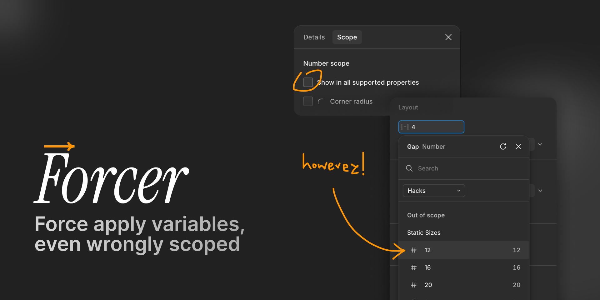

# Forcer

Figma plugin that binds variables to layer fields **regardless of variable scopes**.

The design system team publishes kit-only variables with empty scopes, so they stay out of other designers' pickers. Figma's UI won't let you bind those variables, but the Plugin API does. Forcer is a short-listed property panel for doing exactly that.



## How to use

1. Select one or more layers.
2. Click a field in Size, Layout, Appearance, Fill, Stroke, Effects or Layout guide. The variable picker opens right under it.
3. Pick a collection, search, click a variable. Out-of-scope variables are listed first.
4. Hover a bound field and click the detach icon to unbind it (the current value is kept). Styles have their own detach button.

Fields follow Figma's properties panel: inputs are prefixed with a letter or icon instead of a label. The chevron next to a row reveals more: min and max sizes, individual paddings, corners and stroke sides. Drag the corner of the window to resize it (double-click to reset); the size is remembered.

Bindings apply to the whole selection as a single undo step.

## What can be bound

| Group | Fields |
|---|---|
| Size | width, height, min/max width and height (auto layout or its children) |
| Layout | gap, wrap gap, grid row/column gap, horizontal and vertical padding, padding per side |
| Appearance | opacity, visibility, corner radius (all corners or each corner) |
| Fill | solid color, gradient stop colors |
| Stroke | solid color, gradient stop colors, weight (all sides or each side) |
| Effects | shadow X, Y, blur, spread, color; layer/background blur radius |
| Layout guide | layout grid count/size/gutter/offset |

Not bindable through the API: corner smoothing, progressive blur start radius and offsets, image/video/pattern paints, noise/texture/glass effects.

## Behaviour and edge cases

- **Multiple layers:** only fields shared by every selected layer are shown. Differing values show *Mixed*. Fills, strokes, effects and grids must have the same structure (count, types and order) on every layer, or the group shows a notice and binding is turned off.
- **Styles:** a group with a style applied shows the style chip with a *Detach style* button instead of the fields. Bindings never detach styles silently.
- **Instances:** binding inside an instance creates an override; the plugin shows *Overriding the instance*. Selecting a component set binds the set itself, not its variants.
- **Large selections:** values are read from the first 50 layers. Bindings still go to all of them, in chunks so Figma stays responsive.
- **Failures** (type mismatch, removed layers, fields that don't apply) are reported per layer in the notification. Details are logged in the console.

## Performance notes

- Library collections are listed instantly from cache, then refreshed in the background (the Figma call takes about 2 s).
- A collection's variables load only when you open it. Library variables arrive without scopes or values, so Forcer imports them in the background, 8 at a time (about 3–6 s for 90 variables), and caches scopes and previews for 12 hours.
- Switching collections cancels the background import. Reopening resumes it.

## Development

```
npm i
npm run dev      # watch both bundles
npm run build    # production build
npm run check    # tsc + svelte-check
```

In Figma desktop: Actions `⌘K` › Plugins & Widgets › Import from manifest › `manifest.json`. Open the console with `⌘⌥I`.

### Structure

```
src/
  shared/types.ts      # message protocol and shared types
  code/                # main thread (Figma sandbox), built to dist/code/code.js
    main.ts            # entry: UI, selection tracking, message routing
    selection.ts       # analyses the selection into groups of fields
    fields.ts          # field addressing, read/write of a single field
    apply.ts           # bind/unbind/detach style across the selection
    catalog.ts         # collections, lazy variable loading, import cache
    storage.ts         # fail-safe clientStorage wrappers
  ui/                  # Svelte 5 UI, inlined into one HTML file (dist/ui/index.html)
```

The UI must be a single inlined HTML file because Figma loads it from the `__html__` string, so `vite-plugin-singlefile` is required.

## Feedback

Contact me via e-mail at [nick@qurle.net](mailto:nick@qurle.net?subject=Forcer%20for%20Figma) or [Telegram](http://t.me/qurle).
